<picture>
  <source media="(prefers-color-scheme: dark)" srcset="./assets/banner-dark.svg">
  
</picture>

I build applications and the delivery path around them: containers, pipelines and Kubernetes, with image signatures the cluster checks for itself.

```console
$ kubectl get projects -n koutsompinas
NAME                    KIND          STATUS         STACK
boostflow-thesis        Thesis        Graded 10/10   Jenkins, ArgoCD, Kyverno, Vault
domimorfi               Client site   Live           Astro, Cloudflare Pages, R2
checkpoint-app          Desktop app   v1.1.5         Electron, SQLite, MCP
agones-128tick-engine   Game server   v0.1.0         C++20, Agones, Kubernetes
gsis-monitor            Internship    Completed      Go, FastAPI, TimescaleDB
verdant-stock-tracker   Internship    Completed      Next.js, Prisma, PostgreSQL
gsis-lms                Internship    Completed      Jakarta EE, PrimeFaces, MySQL
```

[dimitrios.koutsompinas@gmail.com](mailto:dimitrios.koutsompinas@gmail.com)
